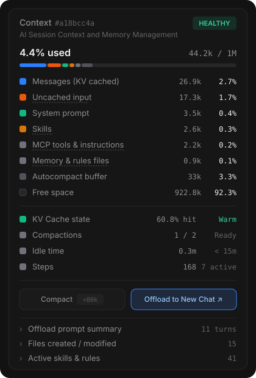
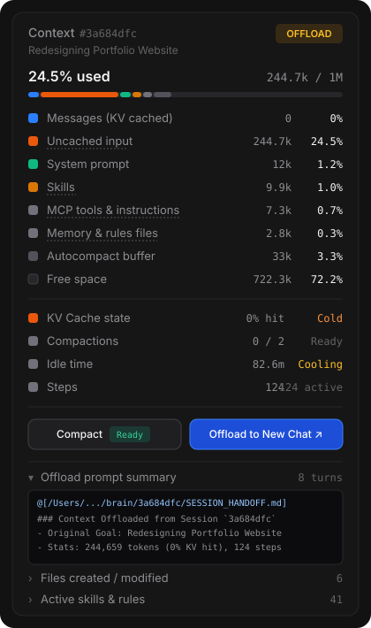
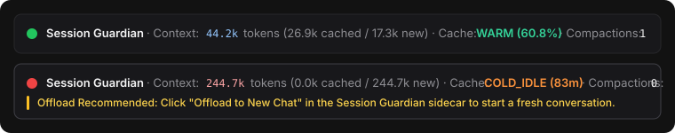

# Session Guardian (`session-guardian`)

**Session Guardian** is a Google Antigravity plugin that monitors how your conversation context is loaded on every turn (`Warm` Gemini KV cache hit vs. `Cold` full history re-read) and provides a Claude-inspired Dark Theme **Context Breakdown Sidecar UI** in the right-hand Auxiliary Pane with automatic left-menu conversation tracking and one-click **Compact** and **Offload to New Chat** actions.

---

## Screenshots

### 1. Sidecar Auxiliary Pane — Healthy vs. Offload-Ready States

When pinned to the right-hand Auxiliary Pane, **Session Guardian** automatically follows whichever conversation you select in the left sidebar menu and updates its context breakdown in real time:

| **Healthy & Warm Session (Post-Compaction)** | **Cold & Offload-Ready Session (`244.7k / 1M`)** |
| :---: | :---: |
|  |  |
| *`4.4% used` (`44.2k / 1M`) · `60.8%` KV cache hit · `1 / 2` compactions · `Compact` disabled (`<80k`)* | *`24.5% used` (`244.7k / 1M`) · `Cold (82.6m idle)` · `Compact Ready` + expanded `Offload prompt summary` preview* |

### 2. Automatic `PreInvocation` Chat Hook Banners

Every turn in chat also displays a concise status badge showing exact cached vs. uncached token counts and alerts you when it is time to run `/compact` or offload:



---

## Features

1. **Claude-Style Dark Theme Context Gauge (Sidecar Auxiliary Pane):**
   - Live `% used` and `tokens / 1M` capacity header with a multi-segment stacked progress bar (`Messages (KV cached)`, `Uncached input`, `System prompt`, `Skills`, `MCP tools & instructions`, `Memory & rules files`, `Autocompact buffer`, and `Free space`).
   - Clean list rows for `KV Cache state`, `Compactions` (`0 / 2`), `Idle time`, and `Steps` (`total` / `active since compact`).
2. **Automatic Left-Menu Conversation Tracking:**
   - Queries Antigravity's Language Server (`GetAllCascadeTrajectories`) and tracks `lastUserViewTime` transitions so clicking any conversation in the left sidebar switches the pinned Sidecar panel within 1 second.
3. **One-Click `Compact` & `Offload to New Chat` Buttons:**
   - **Compact (`/compact`):** Automatically enables when active context reaches `80,000` tokens (or `20+` active steps) and sends `/compact` to the active conversation via `agentapi` (with automatic clipboard fallback).
   - **Offload to New Chat (`↗`):** Extracts your original conversation goals, recent turns, and touched files from `transcript.jsonl`, generates a `SESSION_HANDOFF.md` artifact, and launches a fresh Antigravity conversation pre-seeded with the continuation summary via `agentapi new-conversation`.
4. **`PreInvocation` Lifecycle Hook & On-Demand Telemetry Skill:**
   - Surfaces a non-intrusive status banner in chat and notifies the agent when `alert_level` reaches `COMPACT` (`>= 80k` tokens) or `OFFLOAD` (`>= 2` compactions or `>= 140k` tokens).

---

## Installation

### Option 1: Install via Antigravity CLI (`agy`)
```bash
agy plugin install https://github.com/mattbogado/session-guardian
```

### Option 2: Clone Directly into `~/.gemini/config/plugins/`
```bash
git clone https://github.com/mattbogado/session-guardian ~/.gemini/config/plugins/session-guardian
```
Then restart Antigravity (`Cmd+Q` and reopen) and open the **Session Guardian** panel in the right-hand Auxiliary Pane.

---

## Environment Variables (Optional Tuning)

- `SG_COMPACT_TOKENS` (default: `80000`) — Token threshold for `COMPACT` alert
- `SG_OFFLOAD_TOKENS` (default: `140000`) — Token threshold for `OFFLOAD` alert
- `SG_COMPACT_STEPS` (default: `45`) — Step count threshold since last compaction
- `SG_OFFLOAD_COMPACTIONS` (default: `2`) — Compaction count threshold before offloading is recommended

---

## License

MIT © [Matt Bogado](https://github.com/mattbogado)
